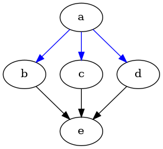

## Implementação de uma biblioteca de Multilayer Perceptron (com Feedforward paralelo e sequencial).

Uma biblioteca que implementa algoritmos de treinamentos de redes neurais de multiplas camadas como feedforward, backpropagation otimizadores como Adam e Rmsprop e regularização L2 e treinamento com  fase de propagação em paralelo utilizando pthreads. 


## Arquitetura do Módulo

### **Rede**

* A topologia é implementada como um grafo dirigido ao contrário de implementações que se utilizam de matrizes para representar camadas. Unidades de neurônios sao implementados como vertices do grafo
se conectando a todos os vertices da camada seguinte.


* A struct network representa a rede
o campo `struct grafo * neuronios` representa a topologia literalmente e o campo `struct camadas * layers` serve de utilitário para implementação dos algoritmos tornando os mais simples e com separaçao de reponsabilidades o campo  **neuronios** guarda a estrutura enquanto que **layers** representa as camadas. 

### **Estruturas que representam a rede**
```c
struct network
{
    int camadas;
    struct grafo * neuronios;
    struct camadas * layers;
    int num_neuronios;
};


struct camadas
{   
    struct vertices **neurons;  // Ponteiros para os vertices no grafo
    int num_neurons;
};
```

### exemplo 
 * grafo/rede com uma entrada e uma saída e uma camada intermediária de três neurônios/vertices.




### **Implementação do grafo**
```c
struct adjacencia
{
    int vertice;
    float peso;
    float media_movel;      // Usado para RMSProp/Adam (E[g^2])
    float media_movel_adam; // Usado para Adam (m)
    struct adjacencia * prox;
};


struct vertices
{
    struct adjacencia * cabeca; 
    int numero_do_vertice;
    float saida;
    float saida_esperada;
    float delta; // Erro retropropagado (gradiente)
};


struct grafo
{
    int vertices;
    int arestas;
    struct vertices *adj;       
};
```

* A implementação em grafos benefícia construir topologias diversas entre números de nodos entre camadas de entrada e saída de forma mais facil sem depender de transposições de matrizes para aplicar a fase de propagação. 

```c
    // criação da topologia 
    int camadas[] = {1, 3, 1, -1 /* fim array */};
    // criacao de fato da rede
    struct network *net = cria_network(camadas);

    // outra possivel topologia
    int camadas[] = {2, 3, 4, 5, 1, -1 /* fim array */};
    // criacao de fato da rede
    struct network *net = cria_network(camadas);
```

## Treinamento

### **FeedForward Paralelo**

* O treinamento paralelo funciona de forma simples utiliza-se de conjuntos de threads no padrão  produtor/consumidor.

* A thread produtora posta em uma fila um conjunto de neurônios aptos a serem processados pela  consumidora e outras threads aguardam a liberação para seguir com processamento de seus neurônios. Quando as consumidoras finalizam a camada atual um pthread_cond_signal é realizado na variavel( `cond2`) de condição que sinaliza que a produtora pode continuar com as inserções de neurônios de camadas posteriores na fila de trabalho.

#### um trecho de código da thread consumidora 

```c
    while (1)
    {
        // Espera por trabalho na fila
        pthread_mutex_lock(&mutex);
		    while (queue_len(&queue) == 0)
		        pthread_cond_wait(&cond, &mutex);

            //pega um neuronio da fila para processar
		    dequeue(&queue, &neuron_idx);

        pthread_mutex_unlock(&mutex);

        // Processa o neurônio da camada atual
        struct vertices *v_final = net->layers[global_thread_drive.camada_posterior].neurons[neuron_idx];
        float somatorio = 0.0;

        for (int k = 0; k < net->layers[global_thread_drive.camada_anterior].num_neurons; k++)
        {
           
            struct vertices *v_inicio = net->layers[global_thread_drive.camada_anterior].neurons[k];
            float peso = busca_na_lista(v_final->numero_do_vertice,v_inicio);
            somatorio += v_inicio->saida * peso;
        }

        v_final->saida = sigmoide(somatorio);

        pthread_mutex_lock(&mutex2);
        // os neuronios processados sao adicionados em uma fila auxiliar, quando ela esta completa (se baseia nos numeros de neuronios da camada atual sendo processada) e sinalizado para a thread produtora que ela pode continuar.

		    append(&queue_neurons, &neuron_idx);
		    if (queue_len(&queue_neurons) == global_thread_drive.num_neuron_por_camada[global_thread_drive.camada_posterior])
		    {	
		        pthread_cond_signal(&cond2); // Sinaliza que a camada foi completamente processada
		    }
        pthread_mutex_unlock(&mutex2);
    }
```


## Fase de Retropropagação

### Backpropagation

* A implementaçao do backpropagation segue a matemática das derivadas parcíais e regra da cadeia em relação aos pesos de todas as camadas partindo da ultima para as ineferiores em sentido contrário ao feedforward.


```c

void back_propagation(struct network *net)
{
	if (net == NULL)
	{
		puts("parametro de back_propagation nao pode ser NULL");
		return;		
	}

	float somatorio = 0.0;
	
 
	for (int i = net->camadas-1; i > 0; i--)
	{	somatorio = 0.0;

		for (int j = 0; j < net->layers[i].num_neurons; j++)		
		{	struct vertices *v = net->layers[i].neurons[j];
			// camada saida
			if (i == net->camadas-1)
			{	v->delta = (v->saida_esperada - v->saida) * derivada_sigmoide(v->saida);				
				continue;
			}
			//camada escondida
			struct adjacencia *adj = v->cabeca;
			while (adj != NULL)
			{	
				somatorio += adj->peso * net->neuronios->adj[adj->vertice].delta;				
				adj = adj->prox;
			}
			v->delta = somatorio * derivada_sigmoide(v->saida); 
		
		}
	}

	return;
}

```


## Loop de treinamento

### Atualização dos pesos

* A atualiazção dos pesos de feita após a fase de backpropagation utilizando os deltas encontrados em seus respectivos vertices/neurônios.


```c
    /// abordagem padrao
    void atualiza_pesos(struct network *net, float taxa_de_aprendizagem)
{
	if (net == NULL)
	{	puts("parametro -> 'net' nao poder ser NULL em atualiza_pesos");
		return;
	}
	
	for (int i = net->camadas-2; i >= 0; i--)
	{	
 		for (int j = 0; j < net->layers[i].num_neurons; j++)
		{	struct vertices *v     = net->layers[i].neurons[j];
			struct adjacencia *adj = v->cabeca;
			while (adj != NULL)
			{	float delta = net->neuronios->adj[adj->vertice].delta * taxa_de_aprendizagem * v->saida;
				adj->peso   = adj->peso + delta; 
				adj = adj->prox;
			}
		}
	}
	return;
}

```

## Loop principal

* O looping principal coordena as fases de treinamento de uma rede de multiplas camadas.

```c 


void treina_network(struct network *net, float **exemplos, float ** saidas_esperadas, 
					int numero_de_exemplos, float taxa_de_aprendizagem , int epocas)
{
	if (net == NULL || exemplos == NULL || saidas_esperadas == NULL)
	{	puts("parametros em treina_network nao pode ser NULL");
		return;
	}
	
	float erro_total = 0.0;
	

	for (int i = 0; i < epocas; i++)
	{	erro_total = 0.0;

		for (int j = 0; j < numero_de_exemplos; j++)
		{	
            feedfoward(net,exemplos[j], saidas_esperadas[j], 0);			
			float erro = calcula_erro(net);
			erro_total+= erro;			
			back_propagation(net);							
			atualiza_pesos(net, taxa_de_aprendizagem);
		}
		
	}	
	printf("epoca =  %i, erro_medio = %f\n",epocas, erro_total / numero_de_exemplos);	
	return;	
}

```


## Tecnologias Utilizadas

* **Linguagem:** C
* **Bibliotecas:** Pthreads


## Como utilizar a biblioteca
* A interface principal de treinamento a função (`void treina_network(struct network *net, float **exemplos, float ** saidas_esperadas, 
					int numero_de_exemplos, float taxa_de_aprendizagem , int epocas)`) espera um ponteiro  para instância da `struct network{}` (` struct  network * net `)  um vetor de vetores de valores de entradas (` float ** exemplos `) análogo uma parâmetro para saídas esperadas (`float ** saidas_esperadas`) um inteiro representando números de exemplos (`int numero_de_exemplos`) um float para representar a taxa de aprendizagem (`float taxa_de_aprendizagem`) e por fim um inteiro representando o numero de épocas de treinamento (`int epocas`).

* A interface para inicialização `struct network * cria_network(int *camadas)`  recebe apenas como entrada um vetor de inteiros com um terminador especial representado pelo valor `-1`, `(int * camadas)`;

```c
#include "nn_graph.h"
#include "nn_train.h"
#include "nn_parallel.h" // Inclui treina_network2
#include <stdio.h>

void exemplo_uso_xor(int num_epocas, float taxa_aprendizagem)
{
    // Conjunto de dados XOR: 2 entradas, 1 saida
    float *data_train[4];
    float *labels[4];
    
    // Entradas
    data_train[0] = (float[]){0.0f, 0.0f};
    data_train[1] = (float[]){0.0f, 1.0f};
    data_train[2] = (float[]){1.0f, 0.0f};
    data_train[3] = (float[]){1.0f, 1.0f};

    // Saidas Esperadas
    labels[0] = (float[]){0.0f};
    labels[1] = (float[]){1.0f};
    labels[2] = (float[]){1.0f};
    labels[3] = (float[]){0.0f};
    
    // Arquitetura: 2 (Entrada) -> 2 (Oculta) -> 1 (Saida)
    int camadas[] = {2, 2, 1, -1};
    
    struct network *net = cria_network(camadas);

    if (net == NULL) {
        printf("Falha ao criar a rede.\n");
        return;
    }
    


    printf("\n--- Teste 1: Treinamento Sequencial (GD Padrao) ---\n");
    // Otimizador Padrao (GD)
    treina_network(net, data_train, labels, 4, taxa_aprendizagem, num_epocas);

    printf("\n--- Teste 2: Treinamento com Otimizador ADAM ---\n");
    // Otimizador Adam
    treina_network_adam(net, data_train, labels, 4, 0.01f, 100, 0.9f, 0.999f);

    printf("\n--- Teste 0: Treinamento Paralelo (Feedforward com Threads) ---\n");
    
    // Re-cria a rede para resetar os pesos, ou destrói e aloca novamente
    destroi_net(net);
    net = cria_network(camadas); // Recria com novos pesos aleatorios
    treina_network2/*versao paralela*/(net, data_train, labels, 4, taxa_aprendizagem, num_epocas);

    destroi_net(net);
}


//exemplo de como verficar a predicao da rede
void prever_xor(struct network *net, float x1, float x2)
{
    float entradas[] = {x1, x2};
    float saidas_dummy[] = {0.0f}; // Apenas para satisfazer a assinatura

    // Apenas Feedforward
    feedfoward(net, entradas, saidas_dummy, 0);

    // Pega a saida final
    float saida_predita = net->layers[net->camadas - 1].neurons[0]->saida;
    printf("Entrada: (%.0f, %.0f) -> Saida Predita: %.4f\n", x1, x2, saida_predita);
}


int main(void)
{
    exemplo_uso_xor(1000, 0.5f); // 1000 épocas, taxa de 0.5 para GD.
    return 0;
}
```

# Como compilar o exemplo (**main.c**)
* sera gerado um a.out no diretório corrente
```bash
    $ gcc *.c -pthread
```

* ou binário de nome `exemplo_xor`

```bash
    $ gcc *.c -pthread -o exemplo_xor
```


## Possiveis melhorias com boas práticas e Padrões. 

> Após a implementação desta biblioteca continuei meus estudos e acabei caindo em Orientção a objetos e Padrões de POO. O código tem muito a melhorar mas segue uma análise.

*   Com a experiência adquirida com o tempo aprendendo novas técnicas retornando a este código enxerguei alguns problemas que podemos resolver com um pouco de design orientado a objetos e padrões.
    
    * Vou demontrar alguns trechos e como melhorar.

    1. Se analisarmos o arquivo train.h onde fica a interface de funções de treinamento veremos que existem uma funçao para cada abordagem, tanto para atulizar os pesos quanto para o treinamento em si. 
        
    ```c
    
    struct saidas *feedfoward(struct network * net, float * exemplos, float * saidas, int print_saida);
    
    void back_propagation(struct network *net);

    // Otimizadores (Atualizacao de Pesos)
    void atualiza_pesos(struct network *net, float taxa_de_aprendizagem); // GD Básico
    
    void atualiza_pesos_rmsprop(struct network *net, float taxa_de_aprendizagem, float beta);
    
    void atualiza_pesos_adam(struct network *net, float taxa_de_aprendizagem, float beta, float beta2);
    
    void atualiza_pesos_regularizacao_l2(struct network *net, float taxa_de_aprendizagem, float lambda);

    // Funcoes de Treinamento
    void treina_network(struct network *net, float **exemplos, float ** saidas_esperadas,  
                        int numero_de_exemplos, float taxa_de_aprendizagem , int epocas);
    
    void treina_network_rmsprop(struct network *net, float **exemplos, float **saidas_esperadas,int numero_de_exemplos, float taxa_de_aprendizagem, int epocas, float beta);
    
    void treina_network_adam(struct network *net, float **exemplos, float **saidas_esperadas,
                                int numero_de_exemplos, float taxa_de_aprendizagem, int epocas, float beta, float beta2);


    ```

    2. Agora olhando para as implementações delas veremos os problemas, há muita repetição de código e mudança apenas no núcleo dos algorimtos.
    O que fazem  até as funções levarem os nomes descritivos como `atualiza_pesos_rmsprop`  e assim por diante. 

    ```c
    void atualiza_pesos_adam(struct network *net, float taxa_de_aprendizagem, float beta,float beta2)
    {
        if (net == NULL)
        {
            puts("parametro -> 'net' nao pode ser NULL em atualiza_pesos_adam");
            return;
        }

        for (int i = net->camadas - 2; i >= 0; i--)
        {
            for (int j = 0; j < net->layers[i].num_neurons; j++)
            {
                struct vertices *v = net->layers[i].neurons[j];
                struct adjacencia *adj = v->cabeca;

                while (adj != NULL)
                {
                    float gradiente = net->neuronios->adj[adj->vertice].delta;
                    float square_gradiente = gradiente * gradiente;

                    // Atualização do E[g^2]
                    adj->media_movel_adam = adj->media_movel_adam * beta + (1- beta)* gradiente;

                    adj->media_movel = beta2 * adj->media_movel + (1 - beta2) * square_gradiente;

                    float delta = (taxa_de_aprendizagem /sqrt(adj->media_movel)) * adj->media_movel_adam;
                    adj->peso += delta;

                    adj = adj->prox;
                }
            }
        }
        return;
    }


    void atualiza_pesos_rmsprop(struct network *net, float taxa_de_aprendizagem, float beta)
    {
        if (net == NULL)
        {
            puts("parametro -> 'net' nao pode ser NULL em atualiza_pesos_rmsprop");
            return;
        }

        for (int i = net->camadas - 2; i >= 0; i--)
        {
            for (int j = 0; j < net->layers[i].num_neurons; j++)
            {
                struct vertices *v = net->layers[i].neurons[j];
                struct adjacencia *adj = v->cabeca;

                while (adj != NULL)
                {
                    float gradiente = net->neuronios->adj[adj->vertice].delta;
                    float square_gradiente = gradiente * gradiente;

                    // Atualização do E[g^2]
                    adj->media_movel = beta * adj->media_movel + (1 - beta) * square_gradiente;

                    // Atualização do peso usando RMSprop
                    float delta = taxa_de_aprendizagem * gradiente /sqrt(adj->media_movel);
                    adj->peso += delta;

                    adj = adj->prox;
                }
            }
        }
        return;
    }
    ```

    * Podemos ver que o loop que percorre as adjacências de cada vertice/neurônio é o mesmo para todas as funçoẽs e oque muda é a estrategia de atualização de pesos que se torna diferente em cada abordagem.

    ```c

        while (adj != NULL)
        {
            // estrategia de atualizacao vem aqui
            adj = adj->prox;
        }

    ```

    * E voltando a interface train.h ela só tem o número  de funções que tem por que foi necessário que para cada abordagem de treinamento surgisse uma equivalente função que fizesse o treino completo,  sendo uma delas por exemplo `treina_network_adam` e entre outras.

    ### Agora como podemos resolver essas duplicações de código ?

    *   Podemos resolver com uma abordagem simples que se utiliza de um padrão que é o Strategy Pattern.
        #### Um breve resumo do padrão.
        > O Strategy permite trocar o comportamento ou algoritmo de um objeto dinamicamente (em tempo de execução), isolando as regras de negócio e mantendo o código limpo, modular e fácil de expandir.

    *  Faremos algumas adições de estruturas  a base de código para facilitar o processo.

        1. Criaremos uma estrutura que irá encapsular a estratégia e que servirá de  interface.
        ```c
            typedef struct UpdateWeightStrategy {
                void (*strategy)(void* param, float delta, struct adjacencia * adj);
                float leraningRate;  
            } UpdateWeightStrategy;  
        ```
        2. Agora podemos criar as estratégias em si.

        ```c

            struct AdamUpdateStrategy{
                UpadateWeightStrategy strategy;
                float beta1, beta2;
            }

            struct SGDStrategy {
                UpdateWeightStrategy strategy;
            }

            struct RMSpropStrategy{
                UpdateWeightStrategy strategy;
                float beta;
            }

        ```

        * Exemplo de  implementação de uma estratégia 

        ```c
            void AdamStrategy(void* param, float delta, struct adjacencia *adj){

                struct AdamUpdateStrategy * adam = param;   
                float deltaSquare = delta * delta;

				adj->media_movel_adam = adj->media_movel_adam * adam->beta1 + (1- adam->beta1)* delta;
                adj->media_movel = adam->beta2 * adj->media_movel + (1 - adam->beta2) * deltaSquare;
                
                float delta2 = (adam->strategy.learningRate / sqrt(adj->media_movel)) * adj->media_movel_adam;
                
                // atualiza o peso de fato
                adj->peso += delta2;

            }
        ```

        3. Alterações nas APIs
            *  a função de atualizaçao de pesos agora será genérica e ficará assim
            ```c
               atualiza_pesos(struct network * net, UdateWeightSatrategy * estrategia){
                    // aqui vai as verificações de erros como ponteiros nulos e etc... 

                    for (int i = net->camadas - 2; i >= 0; i--)
                    {
                        for (int j = 0; j < net->layers[i].num_neurons; j++)
                        {
                            struct vertices *v = net->layers[i].neurons[j];
                            struct adjacencia *adj = v->cabeca;

                            while (adj != NULL)
                            {
                                float gradiente = net->neuronios->adj[adj->vertice].delta;
                                estrategia->strategy(estrategia, gradiente, adj);
                                adj = adj->prox;
                            }
                        }
                    }    

               } 
            ```

            * Agora podemos ter tambem uma função de treinamento genérica `treina_network()`.

            ```c
                void treina_network(struct network *net, float **exemplos, float ** saidas_esperadas, 
					int numero_de_exemplos, UpdateWeightStrategy * estrategia , int epocas)
                    {
                        if (net == NULL || exemplos == NULL || saidas_esperadas == NULL)
                        {	puts("parametros em treina_network nao pode ser NULL");
                            return;
                        }
                        
                        float erro_total = 0.0;
                        

                        for (int i = 0; i < epocas; i++)
                        {	erro_total = 0.0;

                            for (int j = 0; j < numero_de_exemplos; j++)
                            {	
                                feedfoward(net,exemplos[j], saidas_esperadas[j], 0);			
                                float erro = calcula_erro(net);
                                erro_total+= erro;			
                                back_propagation(net);							
                                atualiza_pesos(net, estrategia);
                            }
                            
                        }		
                        return;	
                    }

            ```


        4. Como utilizar a nova abordagem?

            * basicamante criamos um UpdateWeigthStrategy de interesse e passamos um ponteiro para ele em
            `treina_network()` ficando assim:
            ```c
            
                struct AdamUpdateStrategy estrategia_de_treinamento = {
                    .strategy.strategy = AdamStrategy,
                    .strategy.learningRate = 0.5f,
                    .beta1 = 0.9f,
                    .beta2 = 0.999f
                };

                treina_network(net, 
                            exemplos, 
                            labels,
                            100,
                            (UpdateWeightStrategy*)&estrategia_de_treinamento, 
                            1000 );
             
            ```

## Quais os ganhos da nova abordagem?
    
1. Desacomplamento da função de atualização das regras de como deve ser atualizado.

2. Extensão, novas abordagens podem ser facilmente plugadas sendo necessśrio apenas criar uma 
    nova struct que "herde" de UpdateWeightStrategy e encapsule a sua regra conforme for.